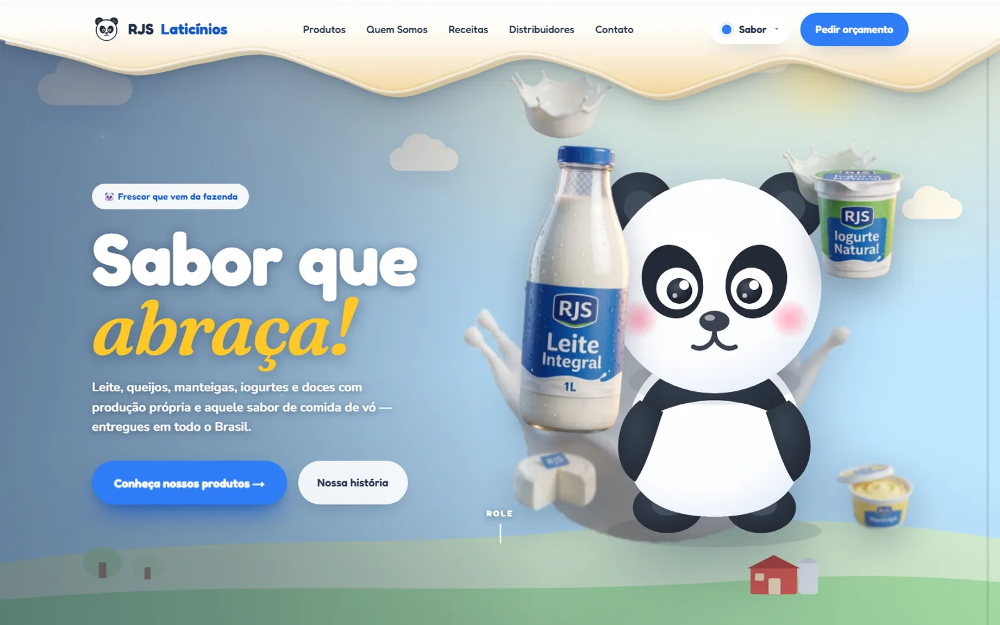
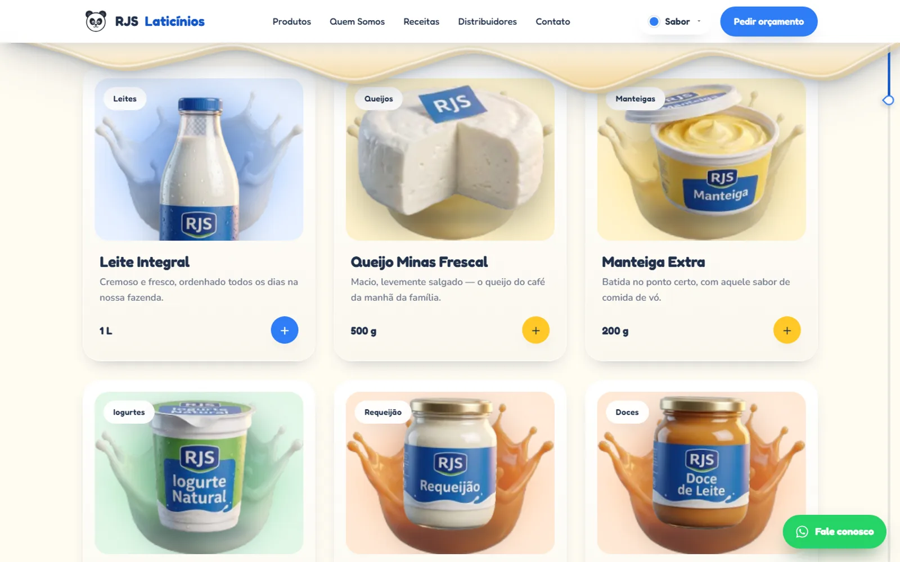

[English](README.md) | **Português**

# RJS Laticínios

Site institucional de uma fábrica de laticínios **fictícia**, feito como peça de portfólio da MilWeb. A marca, os produtos, os depoimentos, os parceiros e os números do site são ilustrativos; não há vínculo com nenhuma empresa real.

> **Tipo:** demo comercial / portfólio (marca fictícia) · **Demo:** https://rjs-laticinios.vercel.app



## Funcionalidades

- Página única com intro animada (toca uma vez por sessão, pode ser pulada e é desligada com `prefers-reduced-motion`).
- Mascote panda em SVG interativo e seção de brincadeira com o panda.
- Seletor de sabor que muda as cores da página (lembrado em `localStorage`).
- Catálogo de produtos com filtro por categoria, ficha em modal acessível e visualização 3D procedural (three / React Three Fiber).
- Receitas, depoimentos, parceiros, estatísticas animadas, CTA e rodapé com contato.
- Botão fixo de WhatsApp como ação principal (não há backend nem formulário).
- `robots.txt` e `sitemap.xml` gerados pelo App Router.



## Stack

- Next.js 15.5 (App Router), React 19, TypeScript
- SCSS Modules (sem Tailwind)
- Framer Motion, GSAP (ScrollTrigger) e Lenis
- three, @react-three/fiber e @react-three/drei
- react-icons

## Como rodar

Pré-requisitos: Node.js 20 ou superior e npm.

```bash
npm ci
npm run dev     # http://localhost:3000
```

| Script | O que faz |
|---|---|
| `npm run dev` | servidor de desenvolvimento |
| `npm run build` | build de produção |
| `npm run start` | serve o build |
| `npm run lint` | ESLint (`next lint`) |

Não há variáveis de ambiente. A URL canônica (`rjslaticinios.com.br`, domínio fictício) fica escrita em `src/app/layout.tsx`, `src/app/robots.ts` e `src/app/sitemap.ts`.

## Estrutura

```
src/
  app/          layout, página, robots, sitemap, ícone, estilos globais
  sections/     seções da página (Hero, Products, Recipes, Footer...)
  components/   navbar, panda, animações, 3D, decoração, UI
  constants/    data.ts: todo o conteúdo mockado (produtos, receitas, contato)
  styles/       tokens e mixins SCSS
public/hero, public/products   renders de produto (ver README de cada pasta)
```

## Limitações

- Todo o conteúdo é estático e fictício; não há backend, carrinho nem formulário.
- O contato usa o WhatsApp comercial da MilWeb (intencional, para demonstração); o e-mail usa o domínio fictício `rjslaticinios.com.br`.
- Não há testes automatizados.

## Créditos das imagens

- Os renders em `public/hero` e `public/products` foram gerados por IA de imagem, conforme os prompts documentados nos README dessas pastas.
- Algumas fotos são carregadas remotamente do Unsplash (`src/constants/data.ts`); a licença de cada foto não foi revalidada.

## Segurança

Veja [SECURITY.md](SECURITY.md).

## Licença

Ainda não há licença definida; todos os direitos reservados ao autor.
